# VIOLENCE

마인크래프트 **26.3** (Paper) 서버용, 속도감 있는 1/3인칭 **데스매치 슈터**입니다.
플레이어 8~24명과 NPC가 합쳐 **50명**이 한 맵에서 싸웁니다. 게임은 제한 시간이 끝나거나 누군가 목표 킬 수를 채우면 끝납니다.

- 실시간 전투 엔진(히트스캔 사격, 근접, 투척, 처형, 문·유리 물리, NPC AI, 연출)은 자바 플러그인 **ViolenceCore**가 맡습니다.
- 게임 규칙(명령어, 인원 계산, 점수표, 콤보 공식, 알림)은 **Skript** 스크립트가 맡습니다.

---

## 폴더 구조

```
Violence/
├─ bukkit/                     ← 바로 실행할 수 있는 서버 폴더
│  ├─ setup.sh / setup.ps1     Paper 26.3 + Skript 2.17.1 자동 다운로드
│  ├─ start.sh / start.bat     서버 시작 (Java 25)
│  ├─ server.properties, eula.txt
│  └─ plugins/
│     ├─ ViolenceCore.jar      빌드된 플러그인
│     ├─ ViolenceCore/resourcepack.zip   빌드된 리소스팩 (플러그인이 자동 배포)
│     └─ Skript/scripts/violence/        game.sk · score.sk · messages.sk
├─ resourcepack/               ← 리소스팩 원본 (tools/build_pack.py 가 생성)
├─ plugin-src/                 ← ViolenceCore 자바 소스 (Gradle)
└─ tools/                      ← 리소스팩 생성기, 검증 스크립트, 폰트
```

## 빠른 시작

1. Java 25를 설치합니다.
2. 서버 파일을 받습니다.
   ```bash
   cd bukkit
   ```
   ```bash
   ./setup.sh
   ```
   Windows에서는 PowerShell로 `setup.ps1`을 실행합니다.
3. [Minecraft EULA](https://aka.ms/MinecraftEULA)를 읽고 동의하면 `eula.txt`를 `eula=true`로 바꿉니다.
4. 서버를 시작합니다.
   ```bash
   ./start.sh
   ```
5. 리소스팩은 플러그인에 내장된 HTTP 서버(포트 **8163**)가 자동으로 보냅니다.
   - 외부 접속을 받으려면 `plugins/ViolenceCore/config.yml`의 `resource-pack.public-host`에 서버 주소를 넣고, 방화벽에서 8163 포트를 엽니다.
   - 리소스팩을 따로 올려 두었다면 `resource-pack.url`에 그 주소를 넣으면 됩니다.
6. 게임 안에서 `/게임시작`을 입력합니다(OP 권한 필요).

> 처음 각 맵으로 게임을 열면 내장 맵을 생성하는 데 몇 초 걸립니다. 미리 만들어 두려면 `/vio map generate all`을 입력합니다.

## 명령어

| 명령어 | 설명 |
|---|---|
| `/게임시작 [맵] [목표킬] [제한시간(초)]` | 플레이어 수를 세어 NPC를 `50 - 플레이어 수`만큼 채우고 게임을 시작합니다. 맵을 생략하면 무작위입니다. |
| `/게임중단` | 진행 중인 게임을 즉시 끝냅니다. |
| `/컷씬 [이름]` · `/컷씬 다음` · `/컷씬 끝` | 컷씬 다이얼로그를 시작·넘기기·종료합니다(게임 중에는 시작되지 않음). 대사는 어드민 왼클릭으로 넘깁니다. |
| `/vio maps` · `/vio info` | 맵 목록과 현재 상태를 보여 줍니다. |
| `/vio start [맵] [NPC수] [목표킬] [초]` | 엔진을 직접 시작합니다(테스트용). |
| `/vio map generate [맵\|all]` | 내장 맵을 생성해 저장합니다. |
| `/vio map edit <맵>` → `weapon add [무기]` · `weapon remove` · `spawn add\|remove` · `door add\|remove` · `bounds` · `save` · `close` | 맵 편집기입니다. 바닥 무기 배치도 맵과 함께 저장됩니다. |
| `/vio give <무기>` · `/vio mask <가면>` · `/vio offer` | 테스트용입니다. |

맵 id: `apartment_a`, `apartment_b`, `building_a`, `building_b`, `prison`, `sewer`, `restaurant`, `club`

## 조작

| 입력 | 동작 |
|---|---|
| 이동(WASD) | 기본 이동속도가 빠릅니다. 점프와 달리기는 할 수 없습니다. |
| **왼클릭** | 사용: 근접 무기는 휘두르고, 총은 발사합니다. 자동소총은 꾹 누르면 연사됩니다. 맨손은 장갑 낀 두 주먹으로 잽을 날립니다. |
| **우클릭** | 들고 있는 무기를 던집니다. 조준선에 바닥 무기(하얀 테두리)가 있으면 바로 이어서 줍습니다. |
| **Space** | 쓰러진 적 위에서 누르면 올라타 처형합니다. 문 앞에서 누르면 발차기, 가면에 따라 구르기나 무기 빼앗기도 됩니다. |
| **E** | 연속 3/5킬을 하면 인벤토리가 "가면 선택" 화면이 됩니다. 클릭해서 착용합니다. |
| **F** | 가면 능력입니다(데니스·리히터·형사·바이커의 임시 무기). |
| 처형 중 왼클릭 / 우클릭 | 추가 공격 / 내리기 |

핫바 1번 칸과 보조무기(왼손) 칸만 쓰입니다. 나머지 칸, 아이템 버리기, F키 손 바꾸기는 막혀 있습니다.

## 구현된 기능

**전투**
- 히트스캔 총기: 머리에 맞으면 즉사, 몸통에 맞으면 맞은 방향으로 밀려나며 쓰러집니다. 쓰러진 대상은 다시 맞으면 죽습니다.
- 유리는 깨지면서 관통하고, 총알은 문에서 멈추며 그 방향으로 문을 엽니다. 매그넘은 적을 관통하지만 문은 관통하지 못합니다.
- 서버 지연 보상: 쏜 플레이어의 핑만큼 과녁 위치를 되돌려 판정합니다.
- 연사속도는 분당 발사 수 그대로 계산합니다(UZI 1800/min은 틱당 1.5발).
- 근접 무기는 즉사입니다. 맨손은 쓰러뜨리기만 하고, 덩치는 맨손으로 쓰러지지 않습니다. 당구 큐대는 한 번 맞히면 부러져 짧은 큐대가 됩니다.
- 투척: 궤적을 서버가 직접 계산합니다. 투척 전용 무기는 즉사, 단검은 50% 확률로 즉사, 나머지는 쓰러뜨립니다.
- 쓰러진 뒤 3초가 지나면 HP를 모두 회복하며 일어나고, 일어선 뒤 3틱 동안은 이동 외 행동을 할 수 없습니다.

**처형**
- 무기마다 다릅니다: 단검·날붙이는 자동 즉사, 몽둥이류와 맨손은 왼클릭 연타, 총기는 바닥에 버리고 맨손으로 처형합니다. 형사 가면은 총으로 처형할 수 있습니다.
- 처형자와 피처형자 모두 처형자의 살짝 뒤·위 시점으로 바뀌고, 끝나면 각자의 1/3인칭 설정으로 돌아갑니다.

**사망과 리스폰**
- 앞·위에서 자신을 내려다보는 시점 → 검은 화면 페이드 → 2초 뒤 아무에게도 보이지 않는 위치로 이동 → 원래 시점으로 복귀합니다.
- 죽은 자리에는 같은 스킨의 시체와 피 웅덩이가 남습니다.

**무기**
- 근접 16종, 총기 9종(샷건, 더블배럴, M16, UZI, 소음기 피스톨, 소음기 UZI, 매그넘, MP5, 마크 전용 양손 MP5), 투척 6종입니다.
- 수치는 `weapons.yml`에서 바꿀 수 있습니다.

**맵 8종**
- 아파트 A동(3층 복도식), 아파트 B동(2층 ㄷ자 + 안뜰), 오피스 빌딩(3층), 고층 빌딩 로비(아트리움 + 메자닌), 교도소(2층 감방동), 하수구(미로 터널), 식당(지하 창고 포함), 클럽(댄스홀 + VIP 메자닌)
- 밀어서 여는 문(충돌 판정, 발차기로 크게 열림, 부딪힌 적은 쓰러짐), 깨지는 유리창, 바닥과 책상 위 무기가 있습니다. 무기 수는 참가 인원의 절반입니다.

**NPC**
- 플레이어 모델을 가진 마네킹 엔티티입니다.
- 보행 그리드 A* 길찾기로 움직이며, 무기를 줍고, 사격·돌격·투척·처형을 하고, 소음기 없는 총소리를 쫓아갑니다. NPC끼리도 싸웁니다.

**점수**
- 처치 방식별 점수: 총 100 < 투척 200 < 근접 300 < 맨손 400 < 처형 500.
- 처치 점수는 죽인 사람에게만 0.8초 동안 표시됩니다.
- 10초 콤보는 좌상단에 표시되고, 콤보가 끝나면 보너스 점수가 왼쪽에서 미끄러져 나오며 0.8초 동안 보입니다.

**연출(바닐라 파티클 미사용)**
- 노란 총알 궤적(매그넘은 주황), 총구 화염, 벽과 바닥의 혈흔, 핏방울, 유리 파편, 탄흔
- 사격·처형 시 화면 흔들림
- 연속 1/3/5킬마다 피를 뒤집어씁니다. 3킬부터 화면이 붉게 물들며 계속 흔들리고, 5킬에는 더 심해지며 심장 박동 소리가 납니다.
- HUD는 전용 폰트를 씁니다(Black Han Sans + Bungee).

**가면 21종**
- 리처드, 돈 후안, 그레이엄, 데니스, 조지, 루퍼스, 라미, 윌럼, 피터, 잭, 릭, 브랜던, 얼, 제이크, 리히터, 돼지 학살자, 코리, 마크, 토니, 형사, 바이커
- 모두 요구사항의 능력대로 구현했습니다. 조지는 "주변 적 위치가 벽 너머로 보임"으로 구현했습니다.

## 모델 미리보기

모든 이미지는 리소스팩의 실제 모델 파일을 렌더링한 것입니다.
1인칭 화면은 마인크래프트의 1인칭 아이템 변환(손 위치, FOV 70, 표시 변환)을 그대로 계산해 그렸습니다(`tools/fp_sim.py`). 실제 게임 화면 캡처가 아닙니다.

**1인칭 애니메이션** (왼쪽 위부터 시간 순서)

공격할 때 짧은 아이템 쿨다운을 걸고, 리소스팩이 쿨다운 진행률에 따라 키프레임 모델을 바꿔 보여 줍니다.
- 총: 발사(노란 총구 화염) → 반동 → 반동 잡기 → 평소. 실제로 조준점이 튀는 반동은 없습니다.
  - 모든 총의 총열 연장선이 조준점으로 모이도록 빌드할 때 자동 보정합니다(`build_pack.py`의 `aim_at_crosshair`).
  - 연사 무기(UZI·M16·MP5)는 애니메이션을 발사 간격의 약 2배(UZI 2틱, M16 3틱)로 줄였습니다. 쏠 때마다 화염이 깜빡이고 총이 떨립니다. 화면 흔들림은 쌓이지 않고 약한 잔떨림으로 유지됩니다.
  - 연사 시뮬레이션 GIF: `python3 tools/export_autofire.py` → `build-out/autofire/`
- 근접: 오른쪽으로 젖혔다가 화면을 가로질러 왼쪽 끝까지 길게 벱니다. 왼클릭을 이어서 누르면 오→왼, 왼→오가 번갈아 나오고, 매번 하얀 베기 궤적이 보입니다. 잠깐 멈추면 다시 오→왼부터 시작합니다. 부러진 당구 큐대만 찌르기입니다.
  - 왼→오 동작은 같은 무기의 `<id>_b` 아이템(쿨다운 그룹 `violence:melee_b`)으로 바꿔 끼워 재생합니다. 이때 `hand_animation_on_swap: false`로 손이 내려갔다 올라오지 않게 했습니다.
- 맨주먹: 장갑 낀 두 주먹이 가드를 올리고, 잽을 날립니다. 던진 뒤에도 팔을 뻗는 동작이 나옵니다.

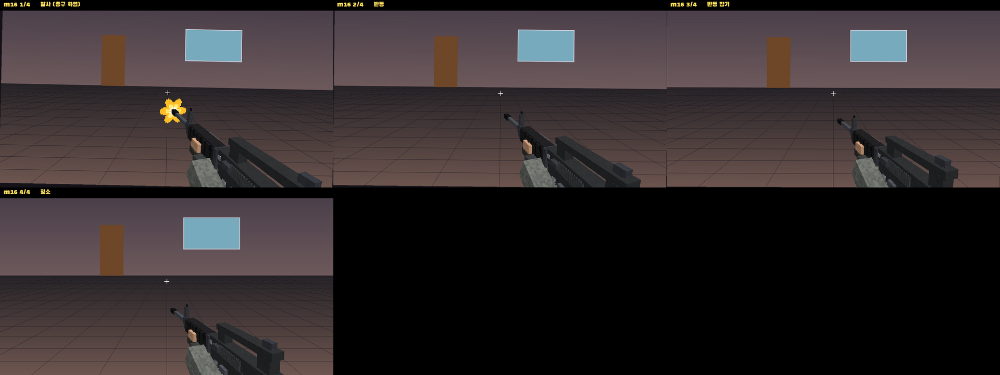
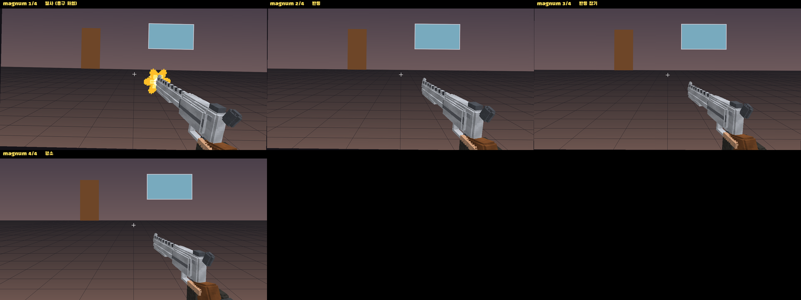
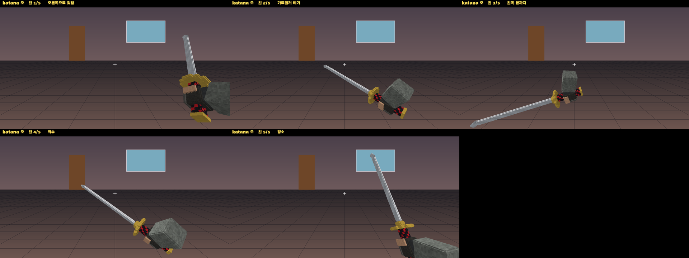
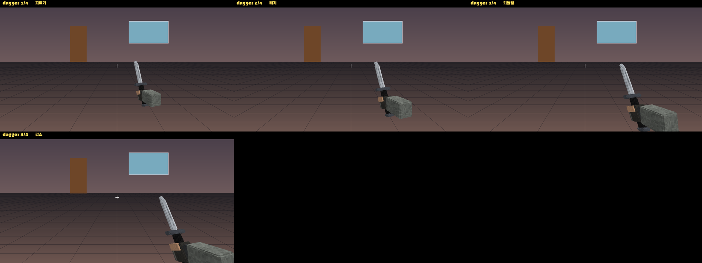
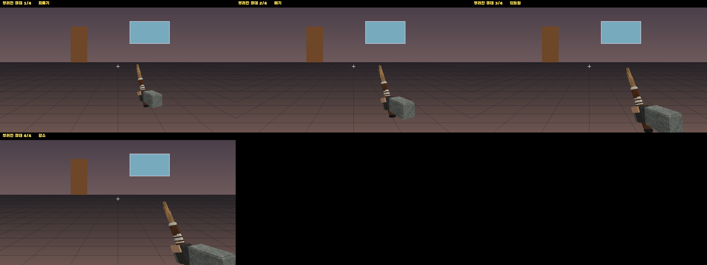
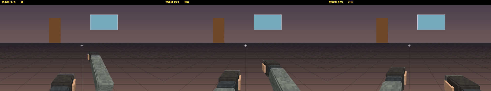

**3인칭 상체 애니메이션 (다른 플레이어가 보는 모습)**

다른 플레이어에게는 들고 있는 아이템을 3인칭용으로 바꿔 보냅니다. 본인 인벤토리는 1인칭용 그대로입니다.
- 양손 총: 장전된 석궁으로 보내서 바닐라의 양팔 조준 자세가 나옵니다. 다리는 이동하면서 따로 움직입니다.
- 권총: 1인칭은 한 손, 3인칭은 한 팔을 앞으로 들어 겨누는 자세입니다(보는 사람에게만 "아이템 사용 중" 상태를 보내 바닐라의 한 팔 들기 자세를 씀).
- 근접 무기: 공격할 때 휘두르는 동작이 보입니다. 부러진 당구 큐대만 찌르기입니다.

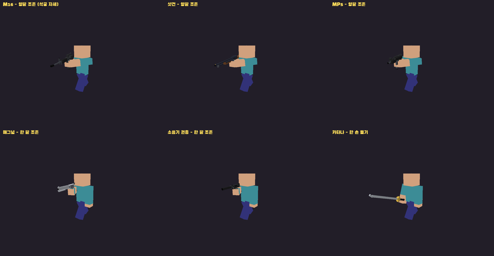

**총기 (TACZ 스타일)**

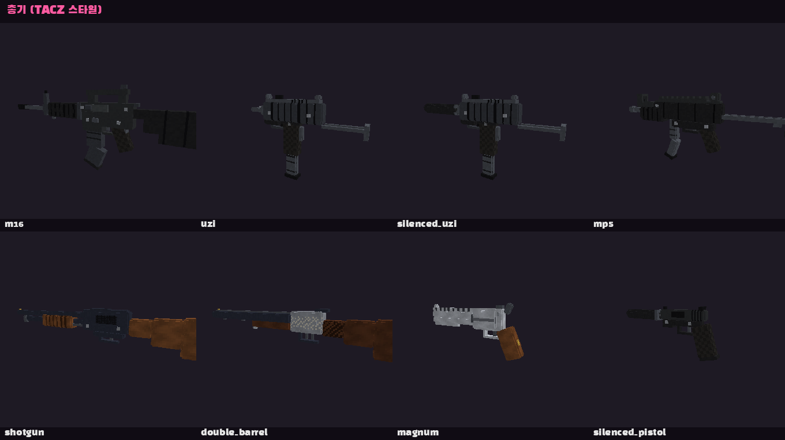

**근접 / 투척 무기**

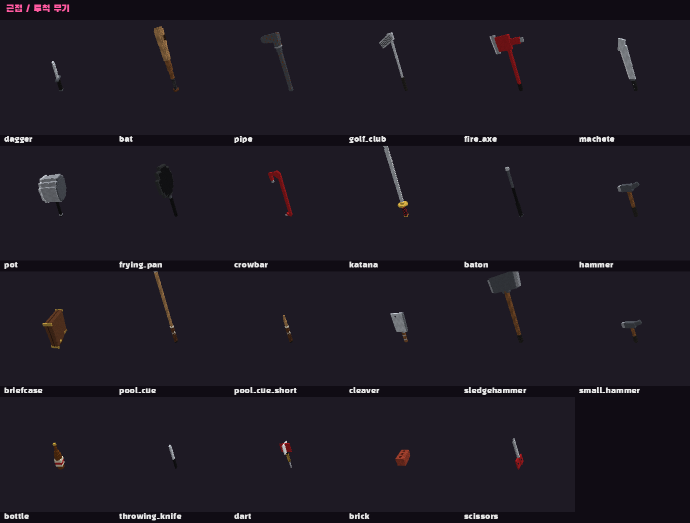

**가면 21종 (복셀)**

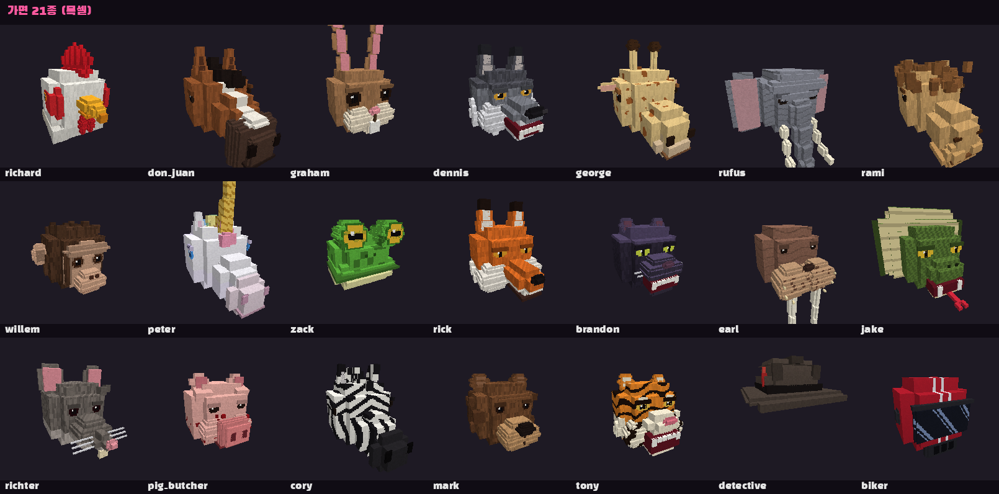

**1인칭 플레이 (줍기 → 연사 → 던지기)**

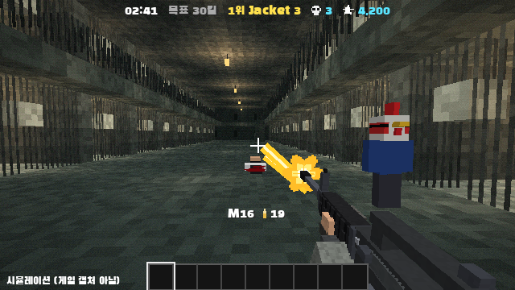

교도소 맵(벅샷 룰렛 쉐이더)에서 바닥의 M16을 조준해 줍고, NPC에게 연사한 뒤 다른 NPC에게 던지는 장면입니다. 리소스팩 모델·쿨다운 프레임·연사 속도·탄 궤적·흔들림을 게임과 같은 규칙으로 계산한 시뮬레이션입니다(`python3 tools/gameplay_preview.py` → `build-out/gameplay/gameplay.gif`). 게임 캡처가 아닙니다.

## 클럽 조명 쉐이더

클럽 맵에서만 켜지는 리소스팩 코어 쉐이더입니다(마인크래프트 26.3 전용).

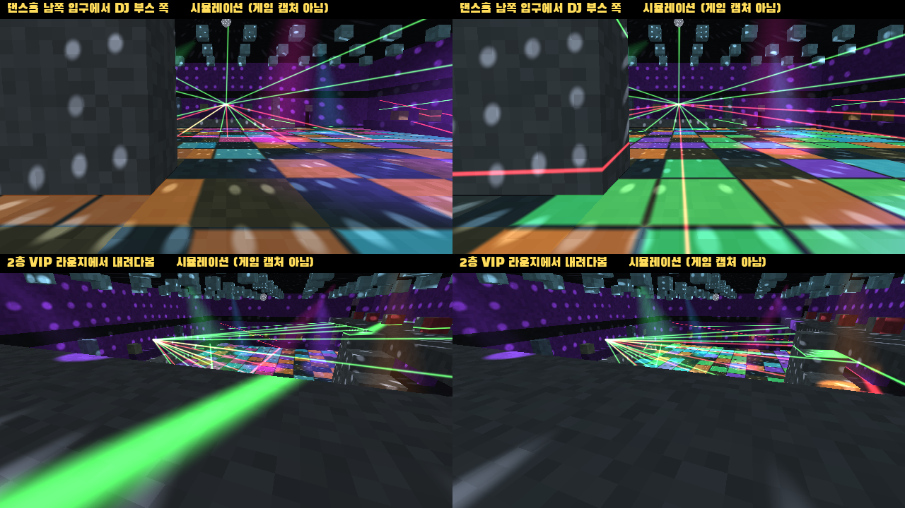

위 그림은 실제 생성된 클럽 맵에 쉐이더와 같은 계산을 적용한 시뮬레이션입니다(`python3 tools/club_preview.py`). 게임 캡처가 아닙니다.

- **무빙 라이트 6개:** 천장에서 색 원뿔이 바닥과 벽을 쓸고 다닙니다. 8박자마다 색이 바뀝니다.
- **레이저:** DJ 부스에서 초록·빨강 레이저 부채꼴이 나와 벽과 바닥에 선을 그립니다. 16박자마다 켜지고 꺼집니다.
- **미러볼:** 홀 천장에서 돌며 벽과 바닥에 빛 점을 뿌립니다.
- **LED 댄스 플로어:** 2×2 타일이 128 BPM 박자에 맞춰 색이 바뀌고 번쩍입니다.
- **분위기:** 클럽 전체가 어두워지고, 홀은 킥 박자에 맞춰 색이 펄스합니다. 홀 밖 방은 보랏빛 네온이 은은하게 깔립니다. 32박자마다 약한 스트로브가 두 번 터집니다(초당 약 2회).

동작 방식:
- 클럽 맵을 y=192 높이에 짓습니다. 쉐이더는 카메라 위치(바닐라 `CameraBlockPos`)가 이 구역 안일 때만 켜집니다. 그래서 다른 맵이나 로비에는 영향이 없습니다. 예전 버전에서 낮은 높이로 저장된 클럽 맵은 자동으로 다시 생성됩니다.
- 블록 표면의 빛(원뿔 자국, 레이저 선, 미러볼 점, 댄스 플로어)은 `terrain` 쉐이더가 그립니다. 공중에 보이는 빛줄기(원뿔, 레이저, 미러볼 모델)는 플러그인 `ClubBeams`가 디스플레이 엔티티로 움직입니다. 둘은 같은 공식(`ClubLights`)과 월드 게임 시간을 써서 맞물립니다.
- 쉐이더 원본: `tools/shaders/` (바닐라 26.3 terrain 쉐이더에 조명 코드만 추가, 바뀐 줄에 `VIOLENCE` 표시)
- 쉐이더는 26.3(리소스팩 형식 97) 전용 오버레이에 들어 있습니다. 다른 버전에서는 무시되어 바닐라 그대로 보입니다.
- 검사: `python3 tools/check_shaders.py`가 glslang으로 게임이 쓰는 define 조합 20가지를 모두 컴파일·링크합니다. 단위 테스트 `ClubLightsTest`는 플러그인 공식과 쉐이더 공식이 같은지, 클럽 맵이 조명 구역 안에 있는지 확인합니다.

제약:
- 바닐라 26.3의 엔티티 쉐이더에서는 카메라 위치를 알 수 없습니다. 그래서 플레이어·NPC 몸에는 색 조명이 비치지 않고 평소 밝기로 보입니다. 대신 적이 잘 보입니다.
- OptiFine·Iris 같은 쉐이더 모드를 켜면 코어 쉐이더가 바뀌어 클럽 조명이 보이지 않습니다.

## 벅샷 룰렛 색감 쉐이더 (아파트 A·B, 교도소)

아파트 A동, 아파트 B동, 교도소에서만 켜지는 리소스팩 코어 쉐이더입니다(26.3 전용). 너무 어둡지 않게 맞췄습니다.

| 교도소 | 아파트 B동 |
|---|---|
| 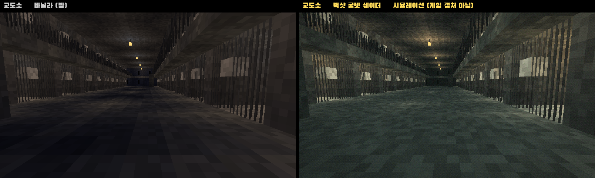 | 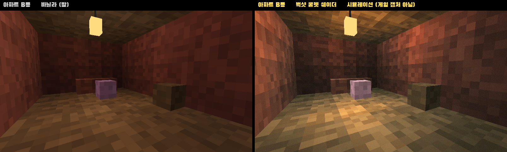 |

왼쪽은 바닐라(밤), 오른쪽은 쉐이더입니다. 실제 생성된 맵에 쉐이더와 같은 계산을 적용한 시뮬레이션입니다(`python3 tools/grim_preview.py`, 결과 `docs/images/grim/`). 게임 캡처가 아닙니다.

- **불빛 웅덩이:** 천장에 매단 전구 아래만 따뜻한 노란빛으로 밝고, 나머지는 녹청색 그림자입니다. 전구는 가끔 형광등처럼 깜빡입니다.
- **어둡지 않게:** 전구가 없는 방도 녹청빛 주변광으로 벽과 바닥이 보입니다(바닐라 밤에는 거의 검은색).
- **질감:** 채도를 낮추고, 멀수록 녹색 안개가 끼며, 필름 그레인, 가장자리 비네트, PS1 느낌의 색 단계와 디더링이 들어갑니다.
- 밝기는 바닐라 라이트맵 대신 블록 밝기(전구에서 떨어진 거리)로 직접 계산합니다. 그래서 플레이어의 밝기 설정과 관계없이 비슷하게 보입니다.

맵 변경:
- 세 맵을 y=128 높이에 짓습니다. 쉐이더는 카메라가 이 높이 대역(y 124~160)에 있을 때만 켜집니다(`ShaderZones`). 예전 높이로 저장된 맵은 자동으로 다시 생성됩니다.
- 조명을 천장에 매단 랜턴으로 바꿨습니다. 예전에는 천장에 박은 조명이 위층 바닥에 덮여 아파트 A동에 불빛이 하나도 없었습니다. 교도소의 레드스톤 램프는 주변 블록이 바뀌면 꺼질 수 있어서 함께 교체했습니다. 교도소 감방마다 전구가 하나씩 매달려 있습니다.

제약은 클럽 쉐이더와 같습니다. 플레이어·NPC 몸과 아이템에는 색감이 적용되지 않습니다. 쉐이더 모드(OptiFine·Iris)를 쓰면 보이지 않습니다.

## 컷씬 다이얼로그

게임과 별개인 진행 연출입니다(핫라인 마이애미 2 대화 장면). 게임이 진행 중일 때는 시작되지 않고, 로비에서 어드민이 `/컷씬`으로 시작합니다.

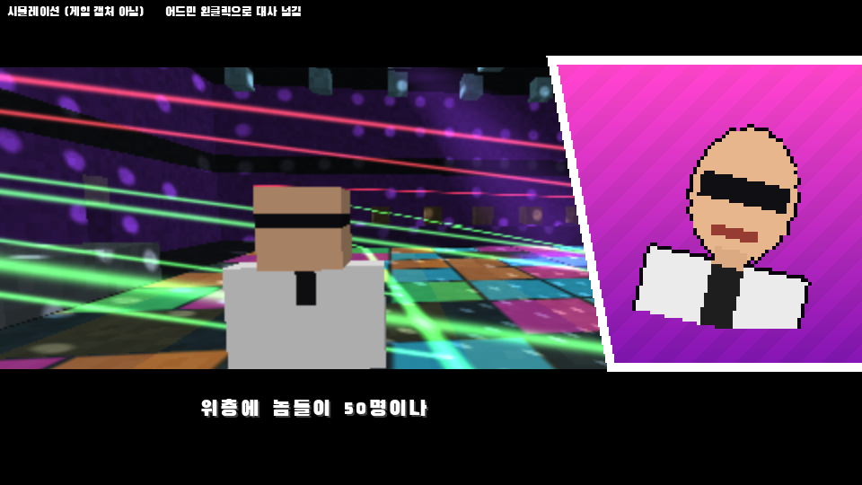

위 그림은 플러그인과 같은 시간표·리소스로 그린 시뮬레이션입니다(`python3 tools/dialog_preview.py`, GIF: `build-out/dialog/dialog_npc.gif`). 게임 캡처가 아닙니다.

- 대사가 나오면 카메라가 지정한 개체를 비추는 자리(얼굴을 비스듬히 앞에서, 패널을 피해 화면 왼쪽)로 easeOutExpo 로 이동합니다.
- 동시에 위아래 검은 띠가 들어오고, 오른쪽에서 자홍색 패널과 초상화가 미끄러져 들어온 뒤, 아래 띠에 대사가 한 글자씩 찍힙니다.
- 초상화는 대사를 넘기기 전까지 왼쪽·오른쪽 15°를 easeInOutSine 으로 반복해서 기웁니다. 말하는 사람이 바뀌면 패널이 잠깐 나갔다가 새 초상화로 들어옵니다.
- 어드민 왼클릭: 타자 중이면 대사 전체를 바로 보여 주고, 다 나왔으면 다음 대사로 넘깁니다. 마지막 대사 뒤에는 컷씬이 끝나고 모두 원래 시점·모드·위치로 돌아갑니다.
- 보는 사람은 관전 모드로 카메라에 붙어 핫바 같은 HUD가 가려지고 움직일 수 없습니다. 어드민은 왼클릭을 써야 하므로 원래 모드로 카메라만 전환됩니다.

컷씬 만들기 (`plugins/Skript/scripts/violence/cutscene.sk`):
```
violenceCutsceneLine(대상 개체, "초상화", "대사")     # 카메라가 대상을 비춤
violenceCutsceneNarration("초상화", "대사")           # 카메라를 옮기지 않음
```
- 초상화: 가면 이름 21종(`richard`, `tony` 등), `npc`, `unknown`, 또는 `tools/portraits/<이름>.png`에 그림을 넣고 리소스팩을 다시 만들면 그 이름으로 쓸 수 있습니다.
- 대사는 두 줄까지 자동으로 줄을 나누고, `\n`으로 직접 나눌 수도 있습니다.
- 예시 컷씬 `intro`가 들어 있습니다. 새 컷씬은 함수를 하나 더 만들고 `/컷씬` 명령어에 이름을 추가하면 됩니다.
- 설정: `config.yml`의 `cutscene.chars-per-tick`(타자 속도), `cutscene.spectate-viewers`(보는 사람을 관전 모드로).

구현 방식: 위아래 띠는 머리 장비의 카메라 오버레이(화면 크기와 관계없이 꽉 참)로, 패널·초상화는 타이틀 글리프로, 대사는 아래로 내린 액션바 글꼴로 그립니다. 글자 폭은 리소스팩 생성기가 글꼴 파일에서 계산해 `plugins/ViolenceCore/cutscene.json`에 넣고, 플러그인이 그 값으로 줄을 가운데 맞춥니다.

제약:
- 패널과 초상화 위치는 GUI 크기 기준이라, 아주 큰 GUI 배율이나 좁은 창에서는 조금 왼쪽에 보일 수 있습니다.
- 대사 글꼴(Black Han Sans)에 없는 드문 한글은 빈 상자로 보입니다(자주 쓰는 2,581자는 들어 있음).

## 설정과 수정

- `plugins/ViolenceCore/config.yml`: 총원(50), 목표 킬, 제한 시간, 무기 비율, NPC 실력, 덩치 비율, 리스폰, 연출 상한, 리소스팩 배포
- `plugins/ViolenceCore/weapons.yml`: 무기 수치(사거리, 공격속도, 탄수, 연사, 퍼짐, 처형 방식, 맵 배치 가중치)
- `plugins/Skript/scripts/violence/score.sk`: 점수표와 콤보 공식. 수정 후 `/sk reload violence`로 바로 적용됩니다.
- Skript가 없으면 플러그인이 `/게임시작`·`/게임중단`을 직접 등록하고, 점수는 config.yml 값을 씁니다.

## 직접 빌드하기

```bash
cd plugin-src
```
```bash
gradle build
```
빌드 결과는 자동으로 `bukkit/plugins/ViolenceCore.jar`에 복사됩니다(Java 25, Gradle 9 이상, repo.papermc.io 접속 필요).

리소스팩을 다시 만들려면(Python 3 + Pillow 필요):
```bash
python3 tools/build_pack.py
```

전체 검증(빌드, 단위 테스트, 리소스팩·쉐이더·Skript 검사)은 이렇게 실행합니다. 쉐이더 검사에는 `glslang-tools`가 필요합니다.
```bash
tools/verify_all.sh
```

## 검증 현황과 알려진 제약

검증한 것:
- 실제 Paper 26.3 API로 경고 없이 컴파일됩니다.
- 단위 테스트 46개가 통과합니다.
  - 순수 로직: 히트박스와 헤드샷 판정, 연사 속도, 산탄 퍼짐, 콤보, 연속킬, 문 물리, 길찾기, 리스폰 선택, 무기 수치
  - 클럽 조명: 플러그인 공식과 쉐이더 공식 일치, 20분 주기에서 끊김 없음, 클럽 맵이 조명 구역 안에 있음
  - 컷씬: 이징 함수, 대사 줄 가운데 정렬과 타자 효과 중 위치 고정, 패널 배치, 가면 초상화 21종 포함
  - 쉐이더 구역: 아파트 A·B, 교도소가 벅샷 색감 구역 안에 있고 매단 전구가 충분한지, 다른 맵이 구역을 침범하지 않는지
  - 맵 생성기 8종: 크기, 무기·리스폰·문 개수, 문 위치, 걸을 수 있는 영역의 연결성, 모든 층의 계단 연결, 리스폰·무기 지점 도달률 90% 이상, NPC 길찾기 성공률
- 쉐이더: glslang으로 게임이 쓰는 define 조합 20가지를 컴파일·링크했습니다.
- 리소스팩: JSON 문법, 모든 모델·텍스처·폰트 참조, 자바 코드와 weapons.yml이 쓰는 모델·사운드가 실제로 있는지 검사했습니다.
- Skript: 들여쓰기, 옵션, 함수 정의와 호출, 자바 훅 이벤트 처리 여부를 정적으로 검사했습니다.

개발 환경 제약 때문에 검증하지 못한 것:
- Paper 서버를 실제로 띄워 보지 못했습니다(Mojang 서버 파일 다운로드가 막혀 있었음).
- 마인크래프트 클라이언트로 화면을 확인하지 못했습니다.
- 그래서 실제 플레이 감각은 [docs/TESTING.md](docs/TESTING.md)의 체크리스트로 확인해 주세요. 대상은 무기 모델의 손 위치, 폰트 위치, 카메라 전환, 화면 흔들림, 자동 연사 감각입니다.

바닐라 클라이언트 구조상의 제약:
- **자동 연사:** 블록(벽·바닥)을 조준한 채 누르고 있을 때만 연사됩니다. 허공(하늘)을 조준하면 클릭당 한 발입니다. 실내 맵이라 대부분 벽이 조준선에 걸립니다.
- **블록 조각 파티클:** 연사 중 조준한 벽에 작은 블록 조각 파티클이 보일 수 있습니다. 클라이언트가 직접 그리는 것이라 서버에서 끌 수 없습니다.
- **몸 애니메이션:** 플레이어 모델의 팔다리를 자유롭게 움직일 수 없어서, 발차기와 처형 동작은 휘두르기·자세·카메라·흔들림·사운드로 표현했습니다.
- **좌상단 콤보 위치:** 보스바 텍스트를 왼쪽으로 밀어서 표시하므로, 화면 크기에 따라 위치가 조금 달라집니다.
- **쉐이더:** 맞춤 쉐이더는 클럽 조명과 아파트·교도소 색감에만 씁니다(위 설명 참고). 붉은 화면은 카메라 오버레이(장비 컴포넌트)로 구현했습니다.

## 게임 밸런스 분석

짧은 TTK가 게임에 미치는 영향과 지루해질 수 있는 경우, 개선 제안은 [docs/TTK_ANALYSIS.md](docs/TTK_ANALYSIS.md)에 정리했습니다(실제 맵 기반 매치 시뮬레이션 `tools/ttk_sim.py`).

## 라이선스와 출처

- 폰트: [Black Han Sans](https://github.com/zesstype/Black-Han-Sans), [Bungee](https://github.com/djrrb/Bungee) — SIL Open Font License 1.1 (`resourcepack/assets/violence/font/*_OFL.txt`)
- 모든 모델·텍스처는 `tools/build_pack.py`가 직접 생성한 것입니다.
- 사운드는 바닐라 효과음을 피치·볼륨만 조정해 씁니다(`sounds.json`). 같은 이름으로 ogg 파일을 넣으면 교체됩니다.
